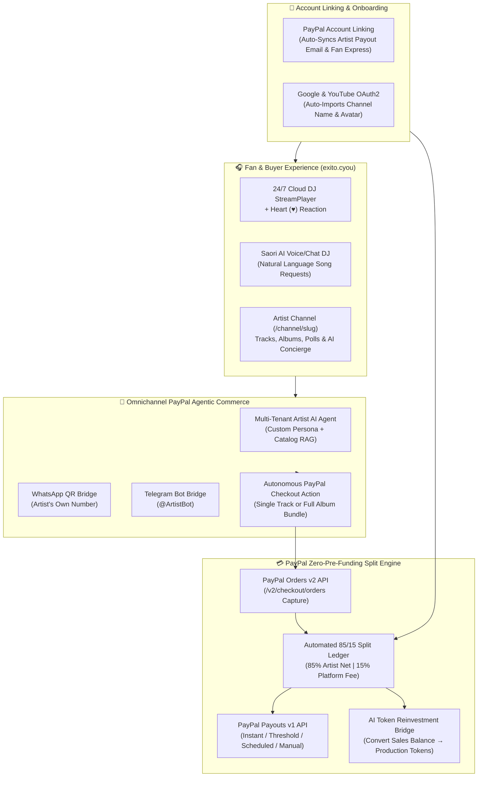

<div align="center">

# 🎵 PayPal Agentic Music Marketplace (`exito.cyou`)

### **Autonomous AI Music Streaming, Cloud DJ Radio & Zero-Pre-Funding PayPal Marketplace for Independent Artists**

[](https://exito.cyou)
[](https://exito.cyou/artist-studio)
[](https://github.com/jonnathanypg/paypal-agentic-music-marketplace/actions/workflows/deploy.yml)
[](https://exito.cyou)
[](./LICENSE)

[](https://developer.paypal.com)
[](https://nextjs.org)
[](https://fastapi.tiangolo.com)
[](https://exito.cyou)
[](./CONTRIBUTING.md)

**🌐 Live Production Demo:** [https://exito.cyou](https://exito.cyou) • **🎤 Artist Studio:** [https://exito.cyou/artist-studio](https://exito.cyou/artist-studio) • **🔐 1-Click PayPal & Google Auth:** [https://exito.cyou/login](https://exito.cyou/login)

</div>

---

## 🚀 Executive Summary

Independent musicians, record labels, and audio creators face a broken monetization model: streaming platforms pay **$0.003 per stream**, while building a direct-to-fan digital storefront with automated split settlements typically requires complex merchant onboarding or upfront working capital (pre-funding).

**PayPal Agentic Music Marketplace (`exito.cyou`)** solves this by combining:
1. **💳 PayPal Account Linking & Instant Artist Sync:**
   - **For Artists:** Logging in with PayPal automatically creates their Artist Channel and synchronizes their PayPal email/Merchant ID (`paypal_verified = True`) so they can immediately start receiving **85% net revenue splits**. Artists can also sign in with **Google OAuth** to auto-import their YouTube channel name and avatar.
   - **For Fans:** Logging in with PayPal pre-links their identity for **1-Click PayPal Express Checkout** and instant high-bitrate MP3/WAV downloads.
2. **💸 Zero-Pre-Funding PayPal Marketplace Split Engine (85% Artist / 15% Platform):**
   - Fans purchase tracks or full album bundles via **PayPal Orders v2 API**.
   - The platform collects 100% of the payment at checkout (zero pre-funding required by the marketplace operator), immediately unlocks physical MP3/WAV downloads for the fan, retains a **15% platform fee**, and credits **85% net revenue** to the artist's ledger.
   - Artists have full flexibility over how they receive their funds via **PayPal Payouts API**: **Instant Payouts**, **Minimum Threshold ($50/$100)**, **Weekly/Monthly Scheduled**, **Manual On-Demand**, or **1-Click Conversion into AI Production Tokens**.
3. **🤖 Conversational PayPal Agentic Commerce (Web, WhatsApp QR & Telegram):**
   - Every independent artist gets a customizable **AI Sales & Fan Concierge Agent** trained on their biography, discography, lyrics, and pricing (`rag_context`).
   - Fans can chat with the artist's AI agent on the web channel (`/channel/[slug]`), via **WhatsApp** (linked via self-service QR code), or **Telegram** to ask for song recommendations and receive **executable in-chat PayPal Checkout Cards** generated autonomously by the agent.
4. **🎙️ 24/7 Cloud DJ ("Saori AI") & Multi-Signal Recommendation Engine:**
   - Fans react to tracks with a **Heart (`♥`)** button (clean UX, zero comment spam).
   - Our proprietary recommendation engine (`/api/artist-studio/recommendations/feed`) combines **PayPal Purchases (+6.0)**, **Saori AI Conversational Requests (+4.0)**, **Heart `♥` Reactions (+3.0)**, and **Stream Completion (+1.5)** to personalize discovery in real time.

---

## 🏗️ System Architecture



---

## 🧪 Judge Testing (PayPal Sandbox — No Real Money)

> **Use this URL for judging:** **https://exito.cyou/?sandbox=1**
>
> **Direct sandbox checkout demo (verified):**
> https://exito.cyou/channel/billionaire-records-demo?buy=2&sandbox=1

The `?sandbox=1` flag shows a yellow **PAYPAL SANDBOX DEMO MODE** banner, loads the
PayPal JS SDK with the sandbox Client ID and sends `sandbox_mode: true` to the
backend, which switches Orders v2 and Payouts v1 to
`https://api-m.sandbox.paypal.com`. Normal production traffic keeps using the
live app.

**Demo application accounts**

| Role | Username | Password |
|---|---|---|
| Artist (full catalog view) | `demojudge` | `PayPalDemo2026!` |
| Buyer / fan (optional) | `demobuyer` | `PayPalDemo2026!` |

Guest checkout works without an application account. The PayPal Sandbox buyer
is already provisioned; credentials and the direct demo-track link are in
[`TESTING.md`](./TESTING.md). **Verified end-to-end on 2026-11-11:** Orders v2
create/capture, captured-amount validation, 85/15 ledger and a completed
PayPal Payouts v1 sandbox batch (`W9B28U85FAL9U`).

Full step-by-step judge flow and troubleshooting: [`TESTING.md`](./TESTING.md).

---

## 🧪 Live Product Walkthrough (Try it in 60 Seconds)

1. **Link a PayPal account or sign in (`/login`):**
   - Visit **[https://exito.cyou/login](https://exito.cyou/login)**.
   - Choose the artist or fan account type, then link a PayPal email and stage name (or continue with Google / YouTube).
   - Your account is created and the PayPal payout destination is stored for the 85% split.
2. **Explore the Independent Artist Studio (`/artist-studio`):**
   - **📊 Analytics & Ranking:** Inspect Spotify-for-Artists style telemetry (total streams, `♥` hearts, subscribers, gross sales, 85% net balance, and conversion rates).
   - **🎵 Upload MP3, Lyrics & Albums:** Upload original MP3/WAV tracks with custom cover art, synchronized lyrics, and individual track pricing, or bundle tracks into a full Album.
   - **💳 PayPal Marketplace & Flexible Payouts:** Switch between **Instant**, **Threshold ($50 USD)**, **Weekly**, **Monthly**, or **Manual** PayPal Payout modes, trigger a live withdrawal, or convert sales balance into AI Tokens.
   - **🤖 AI Agent + WhatsApp QR + Agentic Commerce Simulator:** Customize your artist AI persona, generate a WhatsApp QR code, and test the **Live PayPal Agentic Commerce Simulator** right in the dashboard (e.g., ask *"Recommend me your best track and give me a PayPal checkout link"*).
   - **🗳️ Community Polls & Subscriber Notifications:** Launch interactive fan polls and broadcast announcements to channel subscribers.
3. **Test the Fan Experience & Heart (`♥`) Recommendation Engine (`/` & `/channel/[slug]`):**
   - Click the **`♥` Heart button** in the bottom `StreamPlayer` or on any track card to feed the recommendation engine.
   - Open the **Saori AI Chat** and ask for a musical mood or genre — Saori logs a `saori_chat` signal (`weight: +4.0`) and recommends matching tracks with instant **PayPal Buy & Download** buttons.

---

## 📂 Open-Source Repository Structure

```text
paypal-agentic-music-marketplace/
├── backend/
│   ├── main.py                      # FastAPI application entrypoint
│   ├── db_models.py                 # SQLAlchemy ORM models (ArtistProfile, SplitLedger, Likes, Polls)
│   ├── routers/
│   │   ├── artist_studio.py         # Complete Artist Studio, PayPal Split & Agentic Commerce API
│   │   ├── ecommerce.py             # PayPal Orders v2 capture & automated 85/15 split trigger
│   │   ├── auth.py                  # PayPal account linking, Google OAuth & JWT Auth
│   │   ├── youtube.py               # Google / YouTube Channel OAuth2 callback & sync
│   │   ├── tts_chat.py              # Saori AI Cloud DJ conversational recommendation signals
│   │   └── stream.py                # 24/7 Cloud Radio & live audio streaming router
├── src/
│   ├── app/
│   │   ├── page.tsx                 # Main Streaming & Marketplace Discovery Portal (exito.cyou)
│   │   ├── login/page.tsx           # PayPal-linked & Google OAuth Login UI
│   │   ├── artist-studio/page.tsx   # 5-Tab Independent Artist Studio & PayPal Dashboard
│   │   ├── channel/[slug]/page.tsx  # Public Artist Channel, Album Storefront & Live Polls
│   │   └── portal/page.tsx          # Listener Library, Purchases & Playlists Portal
│   └── components/
│       └── StreamPlayer.tsx         # Global Audio Player with Heart (♥) Reaction & Lyrics
├── TESTING.md                       # Judge access, sandbox demo accounts & troubleshooting
├── DEVPOST_SUBMISSION.md            # Ready-to-paste Devpost copy
├── DEMO_VIDEO_SCRIPT.md             # English 3-minute demo video script
├── CONTRIBUTING.md                  # Open-source contribution guidelines
├── CODE_OF_CONDUCT.md               # Community Code of Conduct
├── SECURITY.md                      # Security & vulnerability disclosure policy
└── LICENSE                          # MIT Open-Source License
```

---

## 🛠️ Local Development & Self-Hosting

> The hosted demo at `https://exito.cyou` is the primary judge path and includes
> the seeded catalog. The public repository does not ship the production MySQL
> catalog or copyrighted audio masters. Tables are created automatically on
> backend startup (SQLite by default); run the seed script below to insert the
> demo catalog and accounts so the PayPal checkout is testable locally. Redis is
> required for Celery.

### 1. Clone & Configure Environment
```bash
git clone https://github.com/jonnathanypg/paypal-agentic-music-marketplace.git
cd paypal-agentic-music-marketplace
cp .env.example .env
```

Configure your PayPal and Google credentials in `.env`:
```env
# Live app (normal production checkout)
PAYPAL_CLIENT_ID=your_live_client_id
PAYPAL_CLIENT_SECRET=your_live_client_secret
PAYPAL_MODE=live

# Sandbox app (used by ?sandbox=1)
PAYPAL_SANDBOX_CLIENT_ID=your_sandbox_client_id
PAYPAL_SANDBOX_CLIENT_SECRET=your_sandbox_client_secret
NEXT_PUBLIC_PAYPAL_SANDBOX_CLIENT_ID=your_sandbox_client_id
NEXT_PUBLIC_PAYPAL_CLIENT_ID=your_live_client_id

GOOGLE_CLIENT_ID=your_google_oauth_client_id
GOOGLE_CLIENT_SECRET=your_google_oauth_client_secret
```

### 2. Start Backend (FastAPI)
```bash
cd backend
python3 -m venv venv
source venv/bin/activate
pip install -r requirements.txt
uvicorn main:app --host 0.0.0.0 --port 8000 --reload
```

### 3. Seed Demo Catalog & Accounts (recommended for local checkout)
```bash
# with the backend virtualenv still active, from backend/
python scripts/seed_demo.py
```

This idempotent script creates the demo catalog (the same ids/prices the UI
falls back to when the API is empty), the `demojudge` / `demobuyer` /
`demoartist` accounts (password `PayPalDemo2026!`) and the
`billionaire-records-demo` artist profile used by the sandbox walkthrough.
Without it, the UI shows mock tracks but `POST /api/ecommerce/paypal/create-order`
returns `404 Recurso no encontrado`, so PayPal never opens.

### 4. Start Frontend (Next.js)
```bash
npm install
npm run dev
```

---

## 🤝 Contributing & Community

We welcome contributions from developers, musicians, and AI researchers! Please read our [Contributing Guide](./CONTRIBUTING.md) and [Code of Conduct](./CODE_OF_CONDUCT.md) before submitting a Pull Request.

## 📄 License

Distributed under the **MIT License**. See [`LICENSE`](./LICENSE) for full details.
